# Pixora – Entity-Relationship (ER) Diagram
## DBMS Course Capstone Project

This diagram documents the logical and physical relational data model of **Pixora**, designed in **Third Normal Form (3NF)** on **MySQL 8.0 (InnoDB)**.

```mermaid
erDiagram
    USERS ||--o{ USER_SETTINGS : "has 1:1"
    USERS ||--o{ PASSWORD_RESETS : "requests"
    USERS ||--o{ POSTS : "authors"
    USERS ||--o{ COMMENTS : "writes"
    USERS ||--o{ POST_LIKES : "likes"
    USERS ||--o{ COMMENT_LIKES : "likes"
    USERS ||--o{ FOLLOWS : "follows / followed_by"
    USERS ||--o{ CLOSE_FRIENDS : "designates"
    USERS ||--o{ BLOCKS : "blocks"
    USERS ||--o{ MUTES : "mutes"
    USERS ||--o{ SAVED_POSTS : "bookmarks"
    USERS ||--o{ COLLECTIONS : "creates"
    USERS ||--o{ STORIES : "shares"
    USERS ||--o{ STORY_VIEWS : "views"
    USERS ||--o{ HIGHLIGHTS : "curates"
    USERS ||--o{ REELS : "uploads"
    USERS ||--o{ REEL_LIKES : "likes"
    USERS ||--o{ REEL_COMMENTS : "comments"
    USERS ||--o{ NOTIFICATIONS : "receives / triggers"
    USERS ||--o{ CONVERSATION_PARTICIPANTS : "joins"
    USERS ||--o{ MESSAGES : "sends"
    USERS ||--o{ MESSAGE_READS : "reads"
    USERS ||--o{ SEARCH_HISTORY : "searches"
    USERS ||--o{ REPORTS : "files / reviews"

    LOCATIONS ||--o{ POSTS : "geotags"

    POSTS ||--|{ POST_MEDIA : "contains 1..10"
    POSTS ||--o{ POST_TAGS : "tags users"
    POSTS ||--o{ COMMENTS : "receives"
    POSTS ||--o{ POST_LIKES : "receives"
    POSTS ||--o{ SAVED_POSTS : "saved as"
    POSTS ||--o{ COLLECTION_ITEMS : "organized in"
    POSTS ||--o{ POST_HASHTAGS : "tagged with"

    HASHTAGS ||--o{ POST_HASHTAGS : "categorizes"

    COMMENTS ||--o{ COMMENTS : "replies to (parent_comment_id)"
    COMMENTS ||--o{ COMMENT_LIKES : "receives"

    COLLECTIONS ||--o{ COLLECTION_ITEMS : "contains"

    REELS ||--o{ REEL_LIKES : "receives"
    REELS ||--o{ REEL_COMMENTS : "receives"

    STORIES ||--o{ STORY_VIEWS : "tracked by"
    STORIES ||--o{ HIGHLIGHT_ITEMS : "grouped into"
    HIGHLIGHTS ||--o{ HIGHLIGHT_ITEMS : "contains"

    CONVERSATIONS ||--|{ CONVERSATION_PARTICIPANTS : "includes"
    CONVERSATIONS ||--o{ MESSAGES : "contains"
    MESSAGES ||--o{ MESSAGE_READS : "read by"

    USERS {
        int user_id PK
        string username UK
        string email UK
        string password_hash
        string full_name
        string bio
        string website
        string avatar_url
        enum gender
        boolean is_private
        boolean is_verified
        boolean is_active
        enum role
        timestamp created_at
        timestamp updated_at
    }

    POSTS {
        int post_id PK
        int user_id FK
        int location_id FK
        text caption
        boolean hide_likes
        boolean comments_disabled
        boolean is_archived
        timestamp created_at
        timestamp updated_at
    }

    POST_MEDIA {
        int media_id PK
        int post_id FK
        enum media_type
        string media_url
        tinyint carousel_order UK
        string aspect_ratio
        timestamp created_at
    }

    FOLLOWS {
        int follower_id PK,FK
        int following_id PK,FK
        enum status
        timestamp created_at
    }

    COMMENTS {
        int comment_id PK
        int post_id FK
        int user_id FK
        int parent_comment_id FK
        varchar content
        boolean is_pinned
        timestamp created_at
        timestamp updated_at
    }

    POST_LIKES {
        int user_id PK,FK
        int post_id PK,FK
        timestamp created_at
    }

    REELS {
        int reel_id PK
        int user_id FK
        string video_url
        string thumbnail_url
        text caption
        int view_count
        timestamp created_at
    }

    STORIES {
        int story_id PK
        int user_id FK
        string media_url
        enum media_type
        boolean is_close_friends_only
        string caption
        datetime expires_at
        timestamp created_at
    }

    CONVERSATIONS {
        int conversation_id PK
        boolean is_group
        string title
        timestamp created_at
        timestamp updated_at
    }

    MESSAGES {
        int message_id PK
        int conversation_id FK
        int sender_id FK
        enum message_type
        text content
        string media_url
        int shared_item_id
        boolean is_deleted
        timestamp created_at
    }

    NOTIFICATIONS {
        int notification_id PK
        int recipient_id FK
        int actor_id FK
        enum type
        int entity_id
        enum entity_type
        boolean is_read
        timestamp created_at
    }
```

---

### Cardinality & Structural Highlights:
1. **Users to Posts**: One-to-Many (`1:N`). A user can author multiple posts; each post belongs to exactly one user (`ON DELETE CASCADE`).
2. **Posts to Media (Carousels)**: One-to-Many (`1:N`). Supports single uploads or multi-item carousels (orders 1 through 10 with composite unique constraint `(post_id, carousel_order)`).
3. **Posts to Hashtags**: Many-to-Many (`M:N`) mediated by associative bridge entity `post_hashtags`.
4. **Follows**: Recursive Many-to-Many (`M:N`) on `users` with `follower_id` and `following_id`, constrained by `chk_no_self_follow`.
5. **Conversations to Messages**: One-to-Many (`1:N`) with composite participant membership table (`conversation_participants`).
